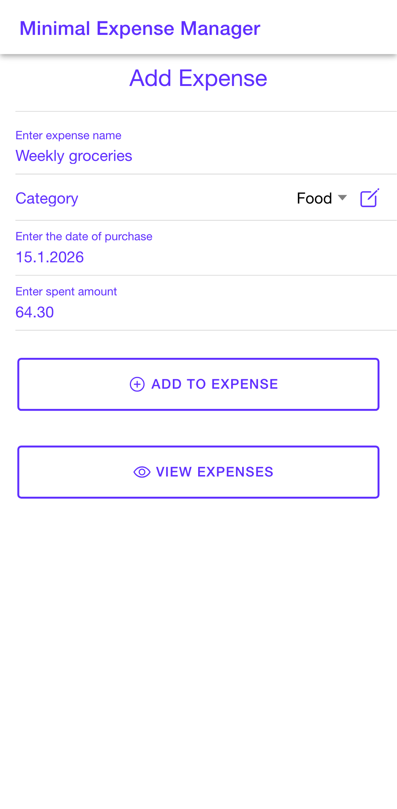
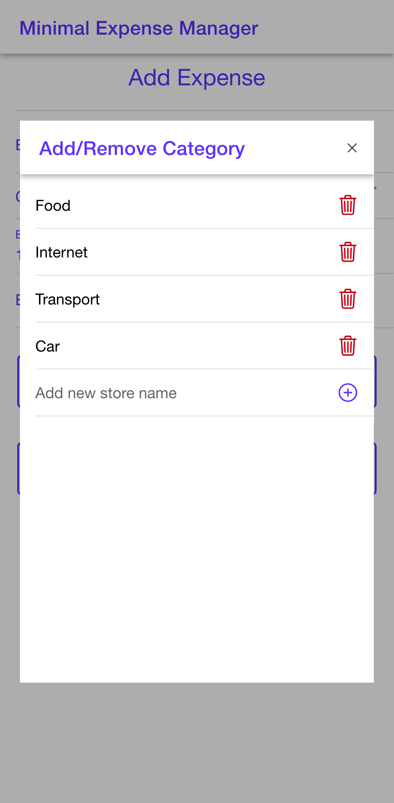
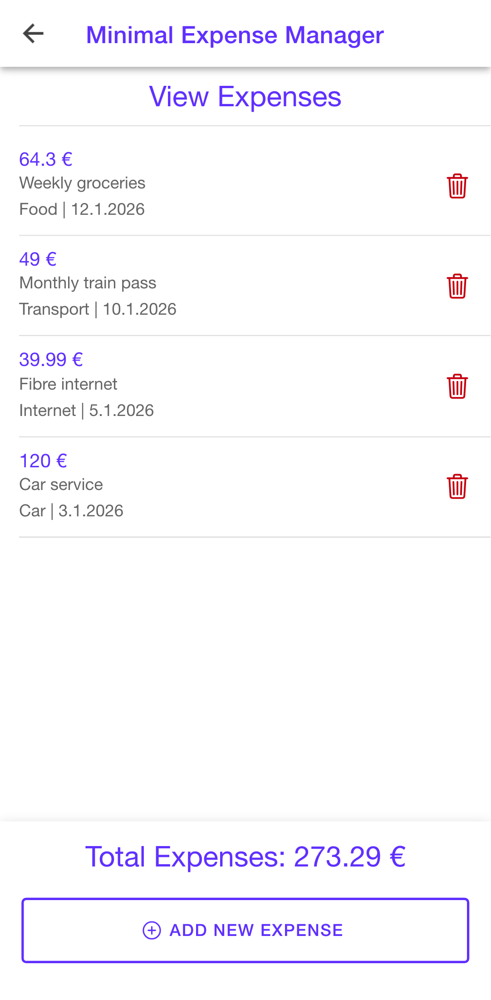

# Simple Ionic Angular App for Managing Personal Expenses

This is an Ionic project designed to manage personal expenses with a minimalistic UI.

The Minimalistic Expense Manager stores data locally, ensuring that personal data stays on your device.

This project uses [Ionic](https://ionicframework.com/) as an app development platform and [Capacitor](https://capacitorjs.com/) to build the Android app.

## Screenshots

<table>
  <tr>
    <th>Add an expense</th>
    <th>Manage categories</th>
    <th>View expenses</th>
  </tr>
  <tr>
    <td>
      <picture>
        <source media="(prefers-color-scheme: dark)" srcset="docs/screenshots/add-expense-dark.png">
        
      </picture>
    </td>
    <td>
      <picture>
        <source media="(prefers-color-scheme: dark)" srcset="docs/screenshots/categories-dark.png">
        
      </picture>
    </td>
    <td>
      <picture>
        <source media="(prefers-color-scheme: dark)" srcset="docs/screenshots/view-expenses-dark.png">
        
      </picture>
    </td>
  </tr>
</table>

<sub>Screenshots follow your GitHub light/dark theme. They are generated automatically from the latest `main` build. See [Updating the screenshots](#updating-the-screenshots).</sub>

## Development

Requires the Node.js version in [`.nvmrc`](.nvmrc) (`nvm use`).

```bash
npm ci            # install dependencies
npm start         # dev server at http://localhost:4200
npm run lint      # ESLint
npm test          # unit tests (Vitest)
npm run build     # production build into www/
npx cap sync android   # copy the build into the Android project
```

## Updating the screenshots

The images in [`docs/screenshots/`](docs/screenshots) are captured by [`scripts/screenshots.mjs`](scripts/screenshots.mjs). The script uses Playwright to open the production build on a Pixel 7-sized screen, in light and dark mode, with fixed demo data and a frozen clock, so the images only change when the UI does.

The **screenshots** job in [`.github/workflows/main.yml`](.github/workflows/main.yml) keeps them up to date:

- **On every push to `main`** (after lint, tests and build pass), it regenerates the screenshots and commits them back to `main` only if something changed.
- **On pull requests**, it uploads the screenshots as a workflow artifact, so reviewers can see UI changes before merging. It does not commit.
- **Manually**, from *Actions → Build Ionic Angular App → Run workflow*.

To generate them locally:

```bash
npx playwright install chromium   # once
npm run build
npm run screenshots
```

Locally generated images can differ slightly from the CI ones (fonts differ between macOS and Linux). The next run on `main` replaces them with the CI version.
